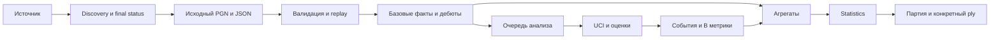

# Проектная спецификация статистики ChessPush

Дата проверки: 15 октября 2026 года. База аудита: commit `15a9678`, ChessPush `0.2.0-alpha.3`. Область — Statistics, сбор собственных завершённых партий и необходимые ей данные. Документ описывает проект; код, пользовательская БД и подключение аккаунта не изменяются.

Статистику следует развивать как проверяемую цепочку **завершённая партия → исходные данные → события на конкретных ходах → показатели → разбор → материал для подготовки**. Первая вертикаль работает без движка. Stockfish добавляет измерение качества решений; сложное распознавание стратегических причин остаётся исследовательской задачей.

Полный каталог с полями из задания находится в [STATISTICS_METRICS.md](STATISTICS_METRICS.md). A/B/C обозначают вычислительную доступность, P0/P1/P2 — приоритет. Числовые пороги ChessPush ниже — проектные параметры, а не универсальные шахматные истины. Факты действующего кода и источников отделены от предлагаемых решений.

## 1 Технический вердикт

1. Активный стек уже Tauri 2 / React / TypeScript / Rust / SQLite. Qt/QML из начала задания — исторический контекст; возвращать его ради Statistics оснований нет.
2. Можно использовать авторизацию, безопасное хранение токена, SQLite, потоковый PGN/ZST-парсер и Chessground. Новые компоненты: ingest завершённых партий, backend replay, часы, аналитические события и UCI-очередь.
3. Персональная выборка определяется проверенным аккаунтом и его связью с партией. Нынешний `source_kind=MyGames` этого не доказывает.
4. Дебютам нужны одновременно позиционный граф с транспозициями и последовательности ходов. ECO — подпись, не замена этим структурам.
5. Потери оценки, Accuracy, использование возможностей, реализация и защита реализуемы локально уже существующими средствами. Их надёжность зависит от анализа, определения события и выборки.
6. Lichess `since/until` ограничивают время создания, а `lastMoveAt` не гарантирует время завершения. Основной механизм — polling, сохранённые pending ID и повторная сверка интервала наблюдения. Полнота около первоначального T0 имеет явное ограничение.
7. MVP — один активный Lichess-аккаунт; синхронизация при запуске и пока ChessPush открыт. Системная служба и универсальная платформа коннекторов не нужны.

## 2 Аудит действующего приложения

### 2.1 Стек

| Компонент | Подтверждённое состояние | Checkout |
|---|---|---|
| ChessPush | 0.2.0-alpha.3 | `package.json:4` |
| React / React DOM | 19.3.0 | `package.json:24` |
| TypeScript / Vite | 7.0.2 / 8.3.1 | `package.json:35` |
| Tauri | Rust lock 2.12.0; JS API / CLI 2.12.0 | `src-tauri/Cargo.lock:3338`, `package.json:21` |
| Rust | edition 2024; локально rustc/cargo 1.98.1 | `src-tauri/Cargo.toml:4`, read-only toolchain audit |
| rusqlite | 0.37.0, bundled и backup | `src-tauri/Cargo.toml:22` |
| SQLite | bundled source 3.50.2; не измерение запущенной пользовательской БД | локальный `libsqlite3-sys-0.35.0/sqlite3/sqlite3.h:149` |
| zstd / reqwest | lock 0.13.3 / 0.13.5; reqwest blocking/native TLS | `src-tauri/Cargo.lock:4848,2645` |
| Доска | официальный `@lichess-org/chessground` 10.4.0 | `package.json:20` |
| Шахматные правила frontend | chessops 0.15.1 | `package.json:23` |

Прежняя реализация — PySide6 / Qt Quick и Python; она сохранена в Git tag `v0.1.0-alpha.1`, а не в активном runtime (`MIGRATION.md:5`). Версии выше взяты из проекта, а не подобраны по последнему релизу.

### 2.2 Существующие возможности

| Область | Есть | Чего нет для Statistics |
|---|---|---|
| GUI | Home, Databases, Settings | Statistics, Knowledge, My Games, Training — placeholders (`src/App.tsx:18,196`) |
| Доска | Chessground, brown/cburnett, координаты, клики, drag, legal destinations, стрелки/кружки, анимация | наличие библиотеки не доказывает соответствие Lichess 1:1; нужна проверка взаимодействия и эталона |
| BoardSession | chessops, FEN, легальная главная линия, cursor, shapes | полноценное PGN tree отсутствует; новый ход после возврата обрезает продолжение |
| Парсер | поток PGN/ZST, bounded buffers, фильтрация metadata до movetext | backend replay, проверка легальности всей партии, нормализованные clocks/evals |
| Хранилище | games, files, file_games, settings, legacy rows; schema v2 | наблюдение аккаунта, moves/positions, analysis runs, метрики |
| Lichess | account status, username/Rapid/Blitz, OAuth PKCE | game export, T0, sync и история рейтинга |
| Учётные данные | Windows Credential Manager, token отсутствует в UI DTO | несколько активных account credentials; другие ОС пока не поддержаны |
| Фоновые операции | spawn_blocking, atomic cancellation, один in-memory parser job | durable очередь и восстановление анализа |
| Движок | отсутствует | UCI, Stockfish, Syzygy и engine settings |

Доказательства: `src/chess/ChessBoard.tsx:2,40,49,80,89`; `BoardSession.ts:77,111`; `src-tauri/src/parser.rs:13,29,45,158`; `application.rs:106,155`; `storage.rs:7,60,66`; `desktop.rs:19,62,159,252`; `lichess.rs:75,155,238,330,370,386`; `credentials.rs:18,42`.

SQLite уже использует WAL, foreign keys, busy timeout 5 секунд и migrations; соединение принадлежит операции. Парсер пишет до 250 партий либо 2 MiB PGN за пакет и flush завершённых записей при отмене. Эти свойства сохраняются. Production HTTP backend отсутствует; loopback listener нужен только OAuth.

### 2.3 Ограничения повторного использования

- Raw PGN и tags сохраняют comments/clocks/evals при их наличии, но `pgn::tokens` удаляет comments/NAG/варианты. Данные не нормализованы; нельзя утверждать, что они всегда утрачены.
- Missing Elo превращается в 0 (`pgn.rs:43`); аналитике нужны nullable ratings. Старый fallback perf по исходным секундам не учитывает полноценно increment (`:46`).
- `move_count` из очищенных токенов не заменяет число проверенных полуходов.
- `import_all` присваивает MyGames всем импортируемым играм без проверки владельца (`application.rs:108`).
- `games.source_kind` хранит первоначальное происхождение; `ON CONFLICT DO NOTHING` не добавляет собственное владение партии из корпуса. Для этого нужна отдельная account-game связь.
- URL parser принимает Lichess ID длиной 8–12 символов (`pgn.rs:111`). Новый ingest берёт canonical public game ID из проверенного API; произвольное обрезание URL недопустимо.
- Аккаунт пока не сохраняет stable external id; Game не содержит typed UTC start/end, rated, variant, participants, clocks или positions.
- Историческая Statistics использовала `PainIndex=n×max(0,0.5−score)`, пороги 2/5, подстановку неизвестных дат и ограниченную загрузку без clocks/evals. Переносить эту методологию не следует; полезны только сценарии WDL и простые fixtures.
- Две темы существуют, но собственный CSS и Segoe UI сами по себе не подтверждают визуальный аналог Lichess. Концептуальный v2-макет не считается утверждённой спецификацией.

### 2.4 Минимальная архитектурная добавка

Сохранить Tauri boundary, storage/migrations, account security, parser и renderer. Добавить конкретные Rust-модули ingest, легального mainline replay, базовых фактов и агрегатов; затем UCI worker. React получает готовые DTO и адреса `(game_id, ply)`, без шахматной бизнес-логики.

Для backend replay сравнить одну связку проверенных Rust-библиотек правил и PGN-reader; кандидаты — [shakmaty](https://github.com/niklasf/shakmaty) и [pgn-reader в актуальном workspace](https://github.com/niklasf/shakmaty/tree/main/pgn-reader). Это предложение новой зависимости, не существующий компонент. Выбор фиксируется после проверки комментариев, FEN/variant, лицензии и fixtures; самописные правила не нужны.

## 3 Сравнение современных решений

| Система | Полезный метод | Что воспроизвести локально | Ограничение |
|---|---|---|---|
| Lichess Insights | метрика × разрез × фильтры; качество, время, фазы, материал | открытые агрегаты и переходы к партиям | часть требует анализа; Accuracy группы отличается от Accuracy партии |
| Chess.com Insights | результаты, качество, дебюты, фазы, время, сопоставимые игроки | вопросы к данным, drill-down | точные составные алгоритмы и эталонные выборки не полностью опубликованы |
| Chess.com Game Review | оценочный график, ключевые решения, повторная попытка | событие → конкретная позиция → повторение | CAPS2 и brilliant/great не являются общим открытым стандартом; глубина меняет классификацию |
| Aimchess | дебют, время, тактика, эндшпиль, реализация, сопротивление | проблема → игровые случаи → материал подготовки | опубликован смысл направлений, но не полный расчёт scores и порогов |
| ChessMonitor | история разных источников, результаты, рейтинг, opening explorer | компактная личная выборка и фильтры | результат зависит от состава истории и соперников |
| OpeningTree | собственные продолжения и результаты | позиционное дерево с партиями | частота не доказывает силу; нормализация FEN требует проверки |
| ChessBase | opening report/reference: продолжения, рейтинг, результаты, модельные партии | отдельный справочный контекст | модельный корпус нельзя смешать с личным |
| Lichess opening explorer | masters/Lichess/player, позиционные ответы | пример разделения корпусов и транспозиций | серверный масштаб и инфраструктуру не переносить в SQLite-MVP |
| En Croissant | открытый desktop React/Rust/Tauri, базы, UCI | технические вертикали и process lifecycle | универсальный GUI не спецификация ChessPush |

Первичные источники: [Lichess metrics](https://github.com/lichess-org/lila/blob/master/modules/insight/src/main/InsightMetric.scala), [dimensions](https://github.com/lichess-org/lila/blob/master/modules/insight/src/main/InsightDimension.scala), [Chess.com Insights](https://support.chess.com/en/articles/8708925-what-is-insights-on-chess-com), [Game Review](https://support.chess.com/en/articles/8584089-how-does-game-review-work), [CAPS2](https://support.chess.com/en/articles/8708970-how-is-accuracy-in-analysis-determined), [Aimchess](https://aimchess.com/), [ChessMonitor](https://www.chessmonitor.com/pricing), [OpeningTree](https://github.com/openingtree/openingtree), [ChessBase Opening Report](https://help.chessbase.com/cbase/17/eng/openings_report.htm), [ChessBase 26](https://cb26.chessbase.com/), [lila-openingexplorer](https://github.com/lichess-org/lila-openingexplorer), [En Croissant](https://github.com/franciscoBSalgueiro/en-croissant).

Стандартны W/D/L, score, разрезы по цвету/контролю, рейтинг, ECO/продолжения, ACPL/Accuracy и ошибки. Для подготовки содержательнее повторяющиеся решения, выход из дебюта, немедленное использование ошибки соперника и сохранение преимущества при известном времени. Недостаточно распространены прозрачное покрытие, неопределённость и сопоставимость analysis profiles; их следует сделать обязательными.

Lichess Tactical Awareness — ограниченный алгоритм: ответ после mistake/blunder соперника успешен, если сам не mistake/blunder. Это не распознавание тактики. Его можно воспроизвести как отдельную метрику «Ответы на ошибки», не как доказанную оценку тактического мастерства. [PovToEntry](https://github.com/lichess-org/lila/blob/master/modules/insight/src/main/PovToEntry.scala).

Отказаться от непрозрачного общего «индекса силы», психологических ярлыков, дебютного рейтинга по трём поражениям, определения знания по скорости и объявления любой потери оценки тактическим мотивом.

## 4 Общие определения

### 4.1 Выборка и качество данных

Единица игровой статистики — уникальная завершённая партия, связанная с проверенным аккаунтом. Единица качества — его легальное решение с пригодными оценками. Единица возможности/реализации — событие или эпизод. Эти знаменатели различны.

Фильтры: account/source, UTC-период, контроль/speed, variant, rated/casual, цвет, opponent rating, дебют, доступность анализа. Default — standard, подтверждённые личные партии после T0. Aborted, unfinished и неизвестный результат не входят в W/D/L; их число сохраняется как статус. Chess960/correspondence и другие варианты — отдельные выборки.

Хранение дат — UTC с явной единицей, интерфейс переводит периоды из пользовательской timezone, по умолчанию Europe/Moscow. Неизвестные Date-поля не заменяются первым числом месяца. Только дата и точный instant — разная точность.

Каждый результат содержит definition version, параметры, фильтр, единицу, numerator/denominator, N партий/решений, покрытие, analysis profile и evidence links. Missing clocks, pending analysis, invalid PGN и вычисленный ноль — разные состояния.

A — вычислимо из PGN/metadata/правил без движка; B — через двигатель или tablebase; C — требует новой семантической модели/валидации. A не означает, что функция уже готова в checkout. Низкая стоимость — replay/SQL; средняя — позиционный индекс, ресэмплинг и расчёт по оценкам; высокая — получение/перепроверка оценок или исследовательская модель.

### 4.2 Результаты рейтинг и активность

При `N=W+D+L`: `win%=100W/N`, `score%=100(W+0.5D)/N`. Победы и набранные очки — разные показатели. Всегда показывать N и W/D/L.

Рейтинг разделяется по `(platform, perf, variant)`. Предыгровой рейтинг, ratingDiff и account snapshot — отдельные наблюдения. Post-rating допустим как pre+diff; следующий account snapshot нельзя подставлять как точное значение сразу после партии. Сохранять provisional/RD, если доступны. T0 snapshot не восстанавливает историю до подключения.

Силу соперников контролировать группами opponent rating и rating difference. Дополнительная дескриптивная Elo-база: `e_i=1/(1+10^((Ropp−Rself)/400))`, `residual=mean(result_i−e_i)`. Для Lichess/Glicko это приближение, не точная вероятность.

Условный перформанс Rp — решение `Σ1/(1+10^((Ropp_i−Rp)/400))=Σresult_i` для однородной шкалы и непредельного score. Все победы/поражения не дают конечного решения. Это не официальный FIDE performance. Приоритет P2: исходные результаты и неопределённость полезнее красивого рейтинга на малом N.

Активность: партии/день, контроли, серии, результаты по порядку в сессии. Сессия — заданное группирование, например gap 30 минут с проверкой 15/60; это не измерение непрерывной игры и не доказательство тильта. Реальную длительность считать при надёжных start/end. `lastMoveAt−createdAt` — доступный интервал до последнего хода, не точное время до завершения.

## 5 Дебютная аналитика

### 5.1 Классификация

Использовать существующий `public/openings.json` как исходный справочник и версионировать отдельно. [lichess-org/chess-openings](https://github.com/lichess-org/chess-openings) предоставляет ECO, имя, PGN и генерируемые UCI/EPD, лицензия CC0. Это каталог названий, не полная теория и не оценка силы хода.

Иерархия ChessPush: семейство → дебют → вариант → подвариант → позиция → пути и продолжения. ECO не задаёт все эти уровни. Двоеточия/запятые в названиях дают подсказки, но parent/alias-связи должны быть явными, а не универсальным split строки. Сохранять исходный header, найденные labels и правило выбора.

Основной label — последняя подходящая именованная позиция главной линии по закреплённой версии справочника. Несколько имён одной позиции остаются aliases; общий N не удваивается. Неименованная позиция всё равно участвует в статистике.

### 5.2 Позиция и последовательность

`opening_position_key=hash(variant, board, side_to_move, castling_rights, legal_en_passant)`. Halfmove/fullmove counters исключаются. EP включается только при легальном взятии по правилам. Права рокировки обязательны.

`line_key` — initial position и последовательность UCI. Каждое посещение: `(game_id, ply, position_key, previous_occurrence, played_uci)`.

- Режим **по позиции** объединяет транспозиции.
- Режим **по линии** оставляет выбранный префикс.
- Частота дебюта считает уникальные партии; время и качество считают решения.
- Агрегированный граф может иметь циклы. UI раскрывает конечный путь и отмечает повторения, а не предполагает DAG.
- Для воспроизведения и правил ничьей сохраняется полная история; opening key её не заменяет.

OpeningTree исключает EP из simplified FEN и отдельно обрабатывает некоторые нелегальные продолжения. Такой ключ нельзя без проверки перенести в ChessPush. [util.js](https://github.com/openingtree/openingtree/blob/master/src/app/util.js), [OpeningGraph](https://github.com/openingtree/openingtree/blob/master/src/app/OpeningGraph.js).

### 5.3 Таблица и дерево продолжений

Каждый уровень: N, частота данным цветом, W/D/L, score, opponent rating/difference, покрытие анализа, loss, серьёзные потери/100, состояние выхода и время. Белые/чёрные и контроли разделены.

В узле: SAN, n_games, n_decisions, доля выбора, W/D/L/score, модельные оценки, медианное spent, связанные партии. Собственные ходы и ответы соперника обозначаются явно. Наблюдавшиеся ходы — основной список; остальные легальные открываются отдельно с «нет партий», без 0% успешности.

Нормированная доля выбора — `n_occurrences(move)/Σn_occurrences(all moves)`. Доля уникальных партий с ходом может суммироваться более 100% при повторении одной позиции; не выдавать её за распределение решений. Для простого режима можно использовать первое посещение позиции на партию и версионировать эту политику.

Популярность, лучший score и подготовленность не означают объективную силу. Модельные/reference партии в будущем показываются отдельным источником и знаменателем.

### 5.4 Слабые места и освоение

Кандидаты: повторяющийся `(position, move)` с loss; частый ответ соперника, после которого ухудшается качество; отрицательный выход; большой расход времени в сопоставимых условиях. Частота × подтверждённая потеря шансов ранжирует объём материала для разбора, не доказывает причину поражения или оптимальный учебный план.

Score требует N/неопределённости/силы соперника; качество — единого profile. Три поражения показываются как три случая. Просмотр многих линий создаёт случайные экстремумы: описательный список допустим, автоматические утверждения о значимости требуют коррекции множественных сравнений.

Динамика освоения: одинаковые позиции/продолжения, loss, повторяемость ошибки, время, ответы соперника, выход. Новый сыгранный вариант не называется освоенным. Без подключённого репертуара PGN не доказывает знание.

### 5.5 Выход и репертуар

Хранить отдельно последнюю именованную позицию, границу фаз и первый выход из подготовленного репертуара. Основное состояние выхода — q на границе фаз с точным ply; дополнительные срезы — последняя именованная позиция и, например, 20 ply как явно фиксированный ориентир. Короткая партия без границы не получает искусственный «выход».

Для выхода: cp/mate/q, первое существенное ухудшение, расход времени, последующий результат. Корреляция не доказывает причинность дебюта.

Будущий PGN-репертуар даёт A-метрики первого собственного отклонения и неизвестного ответа соперника. Сохранять repertoire version, разрешённые ходы, режим position/path. Выход из репертуара не равен ошибке. Сейчас эту интеграцию не реализовывать.


## 6 Качество принимаемых решений

### 6.1 Перспектива и сравниваемые величины

Пусть P — позиция до решения, u — автор хода. Каноническое хранение оценки — White POV плюс исходный root POV; вычисление потери — POV u. При инверсии знак cp/mate меняется, W и L меняются местами, D сохраняется. UCI mate 0/terminal требует отдельного outcome из правил: знак −0 не определяет победителя. Две оценки side-to-move нельзя просто вычитать.

Основное контрактное измерение: лучший результат E*(P) и результат сыгранного хода Ea(P) из одного корня с одинаковой историей и профилем. Для подтверждения Ea применяется UCI searchmoves. Дешёвый проход по соседним позициям годится для кандидатов; его результат имеет отдельный method ID. Одинаковая глубина независимых поисков не доказывает сопоставимость. Особенно опасна разность нормализованных cp до/после изменения материала. [UCI specification](https://backscattering.de/chess/uci/), [Stockfish WDL normalization](https://github.com/official-stockfish/WDL_model).

Сохранять тип cp/mate/tablebase, POV, bound, depth/seldepth, nodes, PV, engine/config, rule context. Lowerbound/upperbound — границы, не точечные значения. Неполный/нестабильный анализ не становится нулевой ошибкой.

### 6.2 ACPL

Для сопоставимых конечных cp: `CPL_i=max(0,cp*_i−cp_played_i)`; `ACPL=ΣCPL_i/n`. Единица — сантипешки шкалы движка, не материально потерянные пешки. Сохранять raw difference; большая отрицательная разность означает несогласие поисков и требует recheck.

Профиль `acpl_raw_finite_v1` исключает mate и показывает число исключений. Совместимый Lichess ACPL отдельно применяет upstream forceAsCp/ограничение cp/POV. Маты нельзя подставлять в raw среднее как 100000 cp. [AccuracyCP](https://github.com/lichess-org/lila/blob/master/modules/analyse/src/main/AccuracyCP.scala), [tree eval](https://github.com/lichess-org/lila/blob/master/modules/tree/src/main/eval.scala).

ACPL вспомогателен: одинаковые 100 cp в равной и уже проигранной позиции имеют разное значение для исхода. Для двух периодов обязательны одна шкала/профиль и покрытие.

### 6.3 Оценочные шансы и WDL

**Lichess transform:** `pL(cp)=100/(1+exp(−0.00368208×cp))`. Это модельное преобразование оценки, не эмпирическая вероятность победы данного пользователя. Для Accuracy upstream ограничивает cp до ±1000 и преобразует mate по специальному правилу. Потеря `LL=max(0,pL*−pL_played)` — процентные пункты pL. [Публичная методика](https://lichess.org/page/accuracy), [scalachess eval](https://github.com/lichess-org/scalachess/blob/master/core/src/main/scala/eval.scala).

**Stockfish WDL:** при W,D,L в промилле `q=(W+0.5D)/1000`; `Lq=100×max(0,q*−q_played)` — процентные пункты ожидаемого очка модели. Хранить W/D/L, поскольку одинаковый q допускает разные шансы победы и ничьей. WDL калиброван на engine self-play, зависит от версии и материала; не прогнозирует результат человека. [WDL model](https://github.com/official-stockfish/WDL_model), [uci.cpp](https://github.com/official-stockfish/Stockfish/blob/master/src/uci.cpp).

Проектный основной профиль — q, полученный через UCI_ShowWDL закреплённого Stockfish. pL и Accuracy — отдельные представления. Нельзя незаметно заполнить отсутствующий q величиной pL. Mate сохраняется как mate; переходы подтверждённого мата выделяются отдельно. При численном отображении mate→0/1 или pL extrema это явная условность профиля, не доказанная вероятность.

### 6.4 Accuracy и ошибки

Публичная приближённая формула хода:
`a=clamp(103.1668×exp(−0.04354×LL_upstream)−3.1669,0,100)`.
Здесь LL_upstream — потеря между соседними before/after оценками по upstream alignment. Same-root LL из §6.3 — отдельная методика сравнения решений; подстановка её в эту функцию допустима только под другим названием и не обещает численного совпадения с Lichess. Для совместимого Accuracy хранить/использовать требуемую последовательность оценок, initial score и upstream преобразование mate.
В просмотренном коде используются коэффициенты 103.1668100711649, −0.04354415386753951, −3.166924740191411 и бонус +1 перед clamp; при неухудшении a=100. [AccuracyPercent](https://github.com/lichess-org/lila/blob/master/modules/analyse/src/main/AccuracyPercent.scala).

Accuracy партии:
`A_game=(Σw_i a_i/Σw_i + H(a_i))/2`.
Окно волатильности — clamp(floor(n_plies/10),2,8); веса — population SD pL в upstream-окнах, ограниченная 0.5…12. В начале повторяется первое окно для выравнивания с парами оценок; сторона выбирает свои ходы, пропуски исключают соответствующую пару/окно. Начальная оценка — upstream initial score, не произвольно заданный ноль.

`H=n/Σ(1/max(1,a_i))`; SD использует делитель n. В Insights Accuracy — это H отдельных ходов выбранной совокупности, без второй части game aggregation. Для фазы алгоритм партии применяется к срезу с предшествующей оценкой. Это три явно именованные агрегации; арифметическое среднее готовых game percentages не равно ни одной автоматически. [Maths](https://github.com/lichess-org/scalalib/blob/master/lila/src/main/scala/Maths.scala), [Insights aggregation](https://github.com/lichess-org/lila/blob/master/modules/insight/src/main/AggregationPipeline.scala).

В Lichess Advice cp-пороги ≥0.1/0.2/0.3 относятся к winningChances −1…+1, то есть к потере 5/10/15 п.п. шкалы pL. Этот путь не делает предварительный cp.ceiled, а mate-классы имеют отдельные ветки. Численную совместимость следует проверять закреплённым upstream и fixtures, а не классифицировать по округлённому UI Accuracy. [Advice](https://github.com/lichess-org/lila/blob/master/modules/tree/src/main/Advice.scala).

Для собственного анализа доступен фильтр **Lq ≥10 п.п.**: операционное существенное ухудшение ожидаемого очка. Это не тот же порог, что Lichess blunder. Показывать распределение и чувствительность 5/10/20 п.п. Частота — события на 100 пригодных личных решений.

### 6.5 Агрегация и интерпретация

Mean/median/P90 loss, доля малых потерь, ошибки/100 и largest cases отвечают разным вопросам. Среднее по ходам даёт больший вес длинным партиям; среднее игровых средних — типичной партии. Оба допустимы только под разными definition ID. Для условно приемлемого состояния считать `q_after≥0.5−ε` только среди решений с `q_before≥0.5`, иначе исходно худшая позиция исказит метрику.

Отдельно учитывать единственные легальные ходы, исходную q, материал и фазу. Высокая Accuracy в простой выигранной позиции не доказывает рост силы. Разброс engine результатов — техническая нестабильность, а не статистический доверительный интервал. Классы/события около порогов повторно проверяются.

## 7 Возможности реализация и защита

### 7.1 Ответ на ошибку соперника

В POV пользователя: q0 до хода соперника, q1 после, q2 после своего ответа. `G=q1−q0`, `R=max(0,q1−q2)`. Все значения имеют единый профиль; подтверждение события использует same-root move evaluations и проверяет согласие с состояниями после ходов.

Предлагаемый `opportunity_v1`: G≥0.10; сильный ответ R≤0.02; использование = strong responses / пригодные возможности. Пороги задают материал с улучшением минимум на десятую долю модельного очка и малой потерей при ответе. Проверять G=0.05/0.10/0.20 и R=0.01/0.02/0.05. Это проектный фильтр, не стандартная оценка тактического мастерства.

Непрерывная величина — `clamp((q2−q0)/(q1−q0),0,1)` при G>0. Если игра закончилась до ответа или нет нужной оценки, случай не входит в знаменатель ответа; статус и количество сохраняются.

Получение возможности, немедленное сохранение и итоговая победа разделены. Пример: 0.50→0.90→0.89 и последующее поражение — ответ использовал возможность, полная реализация не удалась. 0.05→0.45 — защитный ресурс, а не упущенный выигрыш.

Подтверждённый пропуск мата и потеря табличного выигрыша — отдельные B-события. Большой loss и PV сами по себе не определяют вилку/связку/стратегическую причину; это C.

### 7.2 Преимущество

Термин **преимущество по профилю**: q≥0.90. Устойчивый эпизод — два последовательных пригодных личных решения выше порога; начало — первое, подтверждение — второе. Краткие возможности остаются в предыдущей метрике.

q для входа наблюдается перед собственным решением; выход проверяется после каждого доступного хода, включая собственный ответ. Выход — q<0.80; гистерезис не размножает эпизоды около порога. Промежуточный выход обнуляет подтверждение: новая ошибка соперника не склеивает два разных эпизода. Повторный вход возможен после выхода. q=0.90/0.80 и два наблюдения — параметры: сравнить входы 0.80/0.95, одно наблюдение и отдельные cp≥+2/+3 профили. Ни один эвристический порог не доказывает «теоретически выиграно».

Реализация = победы / завершённые партии с подтверждённым входом; на партию один член знаменателя. Дополнительно: score, утрата порога, loss внутри эпизода, первая собственная ошибка, фаза входа. Эпизоды считаются отдельно от партий. Победа по времени — фактическая победа, но не доказательство правильной шахматной реализации.

### 7.3 Защита

Симметричный профиль трудного состояния: q≤0.10, выход q>0.20. Метрики: `(W+D)/N` спасённых партий, score, возврат к q≥0.50, loss защитных решений и использование ресурсов восстановления. Входная q, материал и часы — обязательный контекст.

Защита не обязана повышать q против идеальной игры. Малая собственная потеря лучше описывает сохранение ресурсов. Спасение после ошибки соперника и сильный собственный ответ — разные наблюдения. «Теоретически проиграно» допустимо при соответствующем mate/TB доказательстве, а не только q=0.02.

## 8 Управление временем

### 8.1 Что можно восстановить

Для последовательных ходов **одной стороны**, при послемувовом Fischer increment:
`spent_k=clock_after_(k−1)+increment_k−clock_after_k`.
Это оценка времени, списанного часами, а не точное человеческое размышление.

Нужны оба показания, эффективный контроль стороны, семантика increment и отсутствие неизвестных добавлений времени. У Lichess последний матующий/автоничейный ход может не получить increment; clock history может иметь дополнительную запись асинхронного окончания. Первый ход upstream move-times начинает с нуля, что не доказывает отсутствия размышления. [computeMoveTimes](https://github.com/lichess-org/lila/blob/master/modules/game/src/main/Game.scala).

При неизвестном первом elapsed — missing. Пропуск clock даёт суммарное время группы, а не каждого хода. Отрицательная разность в пределах округления — около нуля с интервалом; большая отрицательная — invalid/изменение часов, без молчаливого max(0,x). Ошибка разности при погрешностях ±e1/±e2 — до e1+e2. Premove, lag compensation и задержки не позволяют назвать recovered time точным временем решения.

Delay, Bronstein, несколько периодов, berserk/handicap, correspondence требуют отдельной семантики. Если она неизвестна, показывать достоверные остатки без spent. У berserk эффективные initial/increment стороны могут отличаться от заголовка.

### 8.2 Показатели

Разделять remaining_before (секунды до решения), remaining_after, spent и `relative_remaining=remaining_before/effective_initial`.

A: median/IQR/p90 spent, суммы по фазам, низкий остаток, поражения по времени, время в повторно встречавшихся позициях. «Встречалась раньше» — факт предыдущего position key; это не доказательство знания.

B: loss/ошибки по remaining и spent, существенные потери после долгого решения, короткие решения при большом остатке. «Долгое/короткое» — собственный квантиль в том же контроле и фазе, а не общее число секунд для bullet/rapid.

Цейтнот представлять операционными диапазонами remaining<10/30/60 с и relative<5%/10%, отдельно по increment. Это измеримые условия, не универсальная граница. Считать и ходы, и партии.

Пример корректного наблюдения: «Потери ≥10 п.п.: 7/84 решений при остатке <30 с». Корреляция не доказывает невнимательность или вред размышления: сложность позиции влияет и на время, и на ошибки.

## 9 Фазы окончания и позиционные признаки

### 9.1 Границы фаз

Основной воспроизводимый вариант — закреплённый Lichess Divider. Middlegame — первая позиция, где осталось ≤10 некоролевских непешечных фигур, либо на домашней горизонтали одной стороны <4 её занятых клеток, либо mixedness>150. Endgame — первая позиция с ≤6 такими фигурами при обнаруженном переходе; совпавшие границы и отсутствующие middle обрабатываются как upstream, а не исправляются догадкой. Mixedness — табличная сумма по 49 регионам 2×2. [Divider](https://github.com/lichess-org/scalachess/blob/master/core/src/main/scala/Divider.scala), [Insights phase assignment](https://github.com/lichess-org/lila/blob/master/modules/insight/src/main/model.scala).

Сохранять исходные API division, локальные boundaries и phase_method_version отдельно. Интервалы полуоткрытые; mapping index позиции/завершённого хода тестируется на upstream fixtures, в том числе на совпадении middle=end. Для From Position хранить абсолютный ply и локальный индекс; стадия такой партии не определяется номером хода.

Альтернатива для sensitivity — материальная фазовая шкала `M=N+B+2R+4Q` обеих сторон (старт 24), развитие фигур и last named opening position. Это отдельная структурная методика, не «точная фаза». Размен ферзей сам по себе не означает эндшпиль. Фиксированный 15-й ход допустим только как контрольный срез.

По фазам показывать долю достигших партий, количество решений, loss, серьёзные ошибки, возможности, время и dynamics. Для отсутствующей фазы не записывать 0.

### 9.2 Типы окончаний

Классификация по составу обеих сторон: пешечные, ладейные, ферзевые, легкие фигуры, разноцветные/одноцветные слоны, смешанные. Хранить точную material signature, а ярлык — versioned grouping. Один game может иметь несколько последовательных типов; число партий и число сегментов раздельно.

Для каждого типа — N, W/D/L/score, начальная q, loss, возможности, реализация/спасение, время и переходы. Условия входа важнее одного game Accuracy. Материальное преимущество определяется A условными весами P1/N3/B3/R5/Q9, но не является движковой оценкой позиции.

### 9.3 Syzygy

Syzygy WDL и DTZ — точные сведения в пределах покрытия/правил. DTZ — расстояние до обнуления счётчика пешечным ходом/взятием, не до мата. Cursed win/blessed loss различают выигрыш без ограничения и результат при правиле 50 ходов. Нужны правильный halfmove counter, история и все необходимые подокончания; castling rights ограничивают probing. [Syzygy](https://github.com/syzygy1/tb), [Syzygy probe semantics](https://python-chess.readthedocs.io/en/latest/syzygy.html).

Включать tabular-result preservation только при успешном rule50-aware root/continuation probe, например через корректный Stockfish root probing. W→D/L и D→L — отдельные события; W→W с большим DTZ не является потерей выигрыша. Missing table не значит draw. Сохранять manifest таблиц и policy; Syzygy50MoveRule=false — другая выборка. [Stockfish tbprobe](https://github.com/official-stockfish/Stockfish/blob/master/src/syzygy/tbprobe.cpp).

Вне покрытия — engine estimate, а не доказанная теоретическая оценка. Автоматические 75 ходов, повторения и доступность требования ничьей учитываются правилами партии; одно FEN без истории недостаточно.

### 9.4 Структуры и стиль

Доступно A: изолированные пешки (нет своей пешки на соседних файлах), сдвоенные (≥2 на файле), проходные (нет пешек соперника впереди на своём/соседних файлах), открытые/полуоткрытые файлы, пешечная signature, материальные дисбалансы, рокировки, факт исчезновения ферзей, структурные переходы. Уточнять геометрию, сторону и версию определения. «Геометрически проходная» не означает, что она безопасно проходит в ферзи.

Отсталость, слабость полей, компенсация, мотив жертвы и причина поражения не следуют из геометрии. Кандидат по явной эвристике возможен, содержательный стратегический диагноз — C с размеченными примерами и измеренной точностью.

Профиль стиля ограничить частотами: дисбалансы, queenless positions, разноцветные рокировки, длина партий, пешечные структуры и распределения q. Считать распространённость на игру и долю решений отдельно. Ярлыки «агрессивный/позиционный/невнимательный» не вводить. Структурные факты — P2 после основных циклов, не стартовый dashboard.

## 10 Прогресс и неопределённость

### 10.1 Сопоставимые условия

Рейтинг, score, качество, conversion, defense, время, дебют и эндшпиль — отдельные временные ряды. Начать с календарных недель/месяцев и последних 50 пригодных партий; окно 50 — настраиваемая политика, не достаточность по определению. Скользящие окна перекрываются и не являются независимыми экспериментами.

Сравнивать platform/perf/variant, exact control, цвет, диапазоны рейтинга и rating difference, исходную q/материал/фазу, один engine profile. Для общих оценок стандартизовать по общим стратам: `M_period=Σw_s M_period,s`, где веса фиксированы по общей базовой выборке. Нет общей страты — нет подстановки нуля и уверенного общего вывода; показывать покрытие сопоставления.

Выбор лёгких позиций и неполный engine analysis могут улучшить среднее без роста навыка. Очередь FIFO по всем подходящим играм уменьшает selection bias; углублённые вручную выбранные события не подменяют стандартную серию.

Контроль объективной человеческой сложности — C. Сейчас доступны её описательные proxies: легальные ходы, материал, исходная q, вынужденный ход, разрыв исследованных вариантов. Они не являются валидированной шкалой трудности.

### 10.2 Интервалы и выбросы

Для биномиальной игровой доли при независимом приближении — Wilson:
`c=(p+z²/(2n))/(1+z²/n)`,
`h=z×sqrt(p(1−p)/n+z²/(4n²))/(1+z²/n)`,
интервал c±h, z≈1.96 для 95%. [NIST](https://www.itl.nist.gov/div898/handbook/prc/section2/prc241.htm).

Score с ничьими не является биномиальной долей побед; использовать bootstrap результатов партий или соответствующую трёхкатегориальную модель. Для событий нескольких ходов одной игры ресэмплировать целые партии с их числителями/знаменателями, не считать ходы независимыми. При выраженных сессиях — block bootstrap по сессиям как sensitivity. [Принцип bootstrap](https://docs.scipy.org/doc/scipy/reference/generated/scipy.stats.bootstrap.html).

Показывать N и интервалы даже при малом N; вывод о тенденции не определяется произвольным «после 10 игр». Практическая политика: при недостаточных данных не рисовать стрелку улучшения; дать исходные значения/диапазон и фактические случаи. Если интервал вырожден из-за одинаковых результатов/нулевых событий, не считать bootstrap доказательством нулевой неопределённости: использовать подходящий интервал/описание ограничения.

Mean чувствителен к крупнейшим потерям, поэтому рядом median/P90 и полный event list; выбросы не удалять без причины invalid data. Неточные часы исключать из spent, сохраняя остальные показатели партии. Для разницы периодов оценивать интервал самой разницы; визуальное перекрытие двух отдельных интервалов не является тестом.

Фразы результата: «Средняя потеря снизилась на X при таких условиях; интервал разницы Y…Z». Утверждение «стал сильнее» требует согласованной картины нескольких показателей и не является доказательством причинного эффекта тренировки.


## 11 Пятнадцать приоритетных показателей

Порядок учитывает проверяемость, связь с решениями и охват основного цикла. **Первые пять — основные в обзоре**; рейтинг и покрытие отображаются рядом как контекст, а не добавляют новые декоративные карточки.

| Место | Показатель | Почему полезен и что доказывает | Доступность |
|---|---|---|---|
| 1 | Набранные очки, W/D/L и N | фактический результат практики; проверяется без движка, отправная точка сравнения | A |
| 2 | Средняя потеря ожидаемого очка q на личное решение | оценивает решения отдельно от результата; список loss ведёт к исправляемым случаям | B |
| 3 | Состояние на выходе из дебюта по вариантам | отличает проблемы первых решений от проигрышей позже; нужен одинаковый boundary/profile | B |
| 4 | Непосредственное использование возможностей | выделяет ответы на ошибки соперника; не смешивает их с поздней реализацией | B |
| 5 | Реализация подтверждённого преимущества | проверяет переход преимущества в победу и показывает места утраты | B |
| 6 | Существенные потери на 100 решений | частота исправляемых эпизодов, нормированная по длине | B |
| 7 | Повторяющиеся потери на одном position+move | прямой материал для повторения и проверки изменения поведения | B |
| 8 | Частота выбора, score и N продолжений в позициях | показывает реальную практику репертуара, включая ответы соперника | A |
| 9 | Ошибки при определённом остатке времени | связывает измеримые условия часов и качество, без психологического диагноза | B |
| 10 | Время в повторно встречающихся дебютных позициях | обнаруживает регулярно затратные решения и динамику их прохождения | A |
| 11 | Сохранение ресурсов и спасённые трудные партии | отделяет собственное качество защиты от ошибок соперника | B |
| 12 | Потеря табличного результата в окончаниях | точные исправляемые события при полном покрытии/правилах | B |
| 13 | Рейтинг по platform/perf и rating difference соперников | внешняя динамика результата и контроль состава оппозиции | A |
| 14 | Loss по фазам и material-type окончания | локализует момент и тип возникающих проблем | B |
| 15 | Изменение loss в сопоставимых условиях | позволяет говорить об изменении наблюдений без смешения контролей/профилей | B |

Обзор не должен ждать B-анализа: сначала показывает A, вместо остальных чисел — статусы «в очереди»/«нет оценок». Accuracy и ACPL доступны в «Качество», но не занимают основные места: они чувствительны к составу позиций и менее непосредственно объясняют задачи подготовки. Время обязательно имеет собственный раздел, даже если не входит в пять обзорных чисел.

Не включать: общий индекс силы/«потенциальный Elo», tilt/aggression scores, сумму штрафов без понятного знаменателя, «лучший дебют» по одному win%, доказанную тактическую ошибку по любому eval swing, причинный «вред изолированной пешки» по корреляции. Их замена — прозрачные случаи, условия, N и проверяемые определения.

## 12 Lichess API и автоматическая синхронизация

### 12.1 Проверенная поддержка export

Основной endpoint — GET /api/games/user/{username}. Предпочтительный ingest — NDJSON с moves и pgnInJson; оригинальный PGN сохраняется вместе с JSON. PGN-only допустим для ручного импорта, но теряет часть структурированных metadata. [Официальная спецификация](https://github.com/lichess-org/api/blob/master/doc/specs/tags/games/api-games-user-username.yaml), [API](https://lichess.org/api), [API tips](https://lichess.org/page/api-tips).

| Параметр | Поддержка и default | Важное для ChessPush |
|---|---|---|
| since / until | milliseconds Unix; без явной границы — история/сейчас | фильтруют createdAt, не завершение |
| sort | dateDesc; доступен dateAsc | сортировка создания, не cursor завершений |
| max | все, если не указан | лимит, не пагинационный токен |
| moves | true | discovery может отключать |
| pgnInJson | false | полный PGN в NDJSON |
| clocks | false | при наличии; JSON centiseconds, PGN %clk |
| evals | false | имеющиеся серверные оценки; новый анализ не запускает |
| accuracy | false | имеющаяся Accuracy, JSON |
| opening | false | классификационные metadata |
| division | false | границы фаз в ply, JSON |
| finished | true | включать завершённые |
| ongoing | false | включать текущие, с задержкой игровых данных |

Текущий controller принудительно включает ongoing при finished=false. Поэтому false/false фактически не означает пустое множество; для active scan использовать явно false/true. [Controller](https://github.com/lichess-org/lila/blob/master/app/controllers/Game.scala).

JSON имеет createdAt, lastMoveAt, status, но отдельный гарантированный endedAt не документирован. В backend since/until идут через Query.createdBetween/F.createdAt; lastMoveAt экспортируется из movedAt. [GameJson](https://github.com/lichess-org/api/blob/master/doc/specs/schemas/GameJson.yaml), [GameApiV2](https://github.com/lichess-org/lila/blob/master/modules/api/src/main/GameApiV2.scala), [Query](https://github.com/lichess-org/lila/blob/master/modules/game/src/main/Query.scala).

### 12.2 Подключение и граница T0

Проектная политика: **включать завершившиеся после T0 независимо старта, насколько это подтверждают доступные данные**.

1. Проверить аккаунт через существующую авторизацию; сохранить stable external account id, platform и username отдельно.
2. После успешного durable подключения зафиксировать immutable T0 UTC и начальные доступные рейтинги. Исходная статистика пуста; старые завершённые партии автоматически не импортируются.
3. Сразу получить active-set user export с finished=false, ongoing=true, moves=false, clocks/evals=false, без max/since и без rated/perfType/analysed/color-фильтров. Сохранить только tracking IDs/status/createdAt. Повторить сверку после первичного подключения.
4. Фильтры статистики применять локально, а не к discovery: иначе незаметно потеряются виды игр и pending.
5. Повторное подключение того же external account сохраняет T0 и данные. Смена аккаунта отключает прежнее наблюдение, не удаляя его игры. T0 не равен времени обновления токена.

Без дополнительных фильтров текущая DB-ветка active export использует nowPlaying и не имеет обязательного max=50. /api/account/playing ограничен 50; /api/user/{username}/current-game возвращает одну текущую или последнюю игру. Они не заменяют полный baseline. Это поведение текущей реализации проверяется контрактными fixtures при внедрении. [Active export code](https://github.com/lichess-org/lila/blob/master/modules/api/src/main/GameApiV2.scala), [account playing](https://github.com/lichess-org/api/blob/master/doc/specs/tags/games/api-account-playing.yaml), [current game](https://github.com/lichess-org/api/blob/master/doc/specs/tags/games/api-user-username-current-game.yaml).

OS credential store и SQLite не образуют общую транзакцию. После аварии startup проверяет identity токена и согласует observation row до sync. Если первое сохранение наблюдения не состоялось, подключение незавершено; нельзя выдумывать утраченное T0 или скачивать историю по времени установки приложения.

### 12.3 Доказательства включения

Хранить eligibility и evidence:

| Случай | Решение |
|---|---|
| createdAt ≥ T0, финальный статус | включить: завершение логически после начала |
| started before T0, источник выдал текущей после T0, затем final | включить по evidence policy, сохранить active observation и пограничную неопределённость; локальное время ответа не равно точному времени активности |
| started before T0, final, достоверный last move ≥ T0 | включить на основании позднего хода; не называть lastMoveAt временем окончания |
| started before T0, final, lastMoveAt < T0, отсутствует active evidence | граница неизвестна; не делать автоматический вывод, что закончилась до T0 |
| неподтверждённый статус/противоречивые metadata | pending/quarantine, без engine queue |

Партия, начавшаяся до T0 и закончившаяся во время первичной неатомарной active-выборки, может не попасть ни в active-set, ни в since=T0. Повторное сканирование снижает риск, но не доказывает полноту. Из неизвестного lastMoveAt нельзя доказать момент сдачи/флага. Кроме того, export читает с secondaryPreferred: запаздывающий started около T0 может относиться к игре, реально закончившейся немного раньше. active-observation — свидетельство состояния источника, не линейно согласованный timestamp. Для таких включений хранить evidence quality и boundary_uncertain; строгий режим обзора по умолчанию исключает погранично неопределённые случаи из основных процентов, сохраняя их отдельно для сверки и явного решения пользователя. [GameRepo](https://github.com/lichess-org/lila/blob/master/modules/game/src/main/GameRepo.scala), [Read preference](https://github.com/lichess-org/lila/blob/master/modules/db/src/main/dsl.scala).

Для этого сохраняются boundary_uncertain и coverage policy; интерфейс показывает фактическую границу и статус покрытия. Можно предложить отдельную ручную сверку пограничных игр с явным включением, не обязательный массовый импорт. Ограниченный lookback сам по себе не гарантирует обнаружение сколь угодно долгой pre-T0 партии.

### 12.4 Устойчивый polling

Предлагаемые 60 секунд между проверками во время открытого приложения и перекрытие 10 минут — стартовые параметры нагрузки, не доказательство полноты. Реальный интервал адаптируется к 429/сети; поздние публикации покрываются reconciliation.

**Состояние:** account/T0, generation, completed creation ranges, discovery high-water, pending IDs, last complete run, retry-not-before, reconciliation cursor, boundary flags. Единственный timestamp не считается покрытием.

**Цикл:**

1. Зафиксировать now_upper и запросить лёгкий NDJSON discovery по creation-окну от max(T0, highwater−overlap) до now_upper, dateAsc, finished=true, ongoing=true, без max и без аналитических фильтров. Игровые ходы текущих партий не загружать для анализа.
2. Каждый завершённый JSON объект сохранить идемпотентно как discovery evidence. Незавершённые добавить/обновить pending. Оборванная строка — partial; курсор диапазона не закрывать.
3. Для final IDs получить полный export с moves, clocks, opening, division, pgnInJson; evals/accuracy при необходимости как отдельное provider evidence. Проверить final status, аккаунт/цвет, ID и PGN.
4. В одной SQLite transaction сохранить raw revision, canonical identity, account_games и durable basic job. Связь account_games добавляется даже при существующей игре корпуса.
5. Высокую границу закрыть только после корректного завершения потока и локальных commits. При ошибке повторить диапазон целиком; уже записанные игры не дублируются.
6. Проверить все pending IDs с учётом backoff, включая начатые до T0. Их нельзя удалять по возрасту. Final переводится в ingest; 404/private/error остаётся unresolved с причиной.
7. Периодически сканировать active-set, чтобы обнаруживать неизвестные ещё текущие игры.
8. Обновить basic aggregates и UI по завершённым транзакциям; engine queue создаётся только для подтверждённо завершённых партий.

Для known IDs доступен отдельный export; batch export принимает до 300 ID. Пакетный ответ может не содержать некоторые игры: отсутствие не является доказательством удаления или завершения. [Один export](https://github.com/lichess-org/api/blob/master/doc/specs/tags/games/game-export-gameId.yaml), [batch export](https://github.com/lichess-org/api/blob/master/doc/specs/tags/games/api-games-export-_ids.yaml).

Окна перекрываются на граничных timestamps; не продвигать timestamp+1 после одной игры. Если диапазон слишком большой, делить по времени, сохраняя overlap границ и состояние каждой части. В DB-ветке диапазон имеет семантику createdAt≥since и createdAt<until. Если все игры имеют timestamp t, запросить [t,t+1 ms) без max, а не since=t&until=t; недоступен полный ответ — оставить диапазон незакрытым. Поисковую ветку core discovery не использует. [dateBetween](https://github.com/lichess-org/lila/blob/master/modules/db/src/main/dsl.scala). Нельзя считать max-обрезанный ответ полным.

### 12.5 Offline поздние публикации и гарантии

При запуске сначала pending и незакрытые диапазоны; затем обычный discovery и reconciliation. Reconciliation повторно проходит **все creation ranges от T0**, частями с сохранённым cursor, без загрузки завершённой истории до T0. На старте запускается новый цикл; при длительной работе — например ежедневно. Это может повторно читать metadata, но не скачивает и не анализирует все PGN заново.

Поздно опубликованная final партия со старым createdAt вне overlap обнаружится полным последующим циклом. Никакое конечное окно не гарантирует покрытие неограниченной задержки. Пока цикл не завершён, UI показывает дату последней сверки и незакрытые диапазоны; «проверено до X» означает конкретную creation-проверку на момент ответа, не математическую гарантию окончательной полноты.

Идемпотентность гарантируется локальным unique(platform, external_game_id), membership unique(account,game), job uniqueness и транзакциями. Полнота условна: публичная доступность источника, корректный ответ, обнаруженные pre-T0 pending, работа приложения и завершённые reconciliation cycles. Необнаруженная пограничная pre-T0 игра и недоступные игры — явные ограничения, а не скрытые нули.

### 12.6 Сеть OAuth и честная игра

Публичный user export не требует дополнительных scopes. Существующий вход можно сохранить без новых прав. Все запросы идут последовательно через Rust, с отдельным учётом source backoff и согласованием с Home refresh. На 429 учитывать Retry-After и минимум минутную паузу; при повторении увеличивать задержку с jitter, не запускать параллельный обход. Для timeout/5xx — bounded exponential backoff; auth failure требует повторного подключения. [Rate limits](https://github.com/lichess-org/api/blob/master/doc/specs/lichess-api.yaml).

/api/stream/event даёт gameStart/gameFinish и при подключении активные игры; один global stream на token. Текущий endpoint принимает любой один из bot:play, board:play, challenge:read. Для обычного аккаунта challenge:read достаточен, но ради уведомлений default-приложение его не запрашивает. Stream — отдельная opt-in оптимизация и сигнал немедленной проверки final, не замена polling. Нет replay cursor; поток не является журналом восстановления. [Stream spec](https://github.com/lichess-org/api/blob/master/doc/specs/tags/board/api-stream-event.yaml), [OAuth any-of](https://github.com/lichess-org/lila/blob/master/modules/oauth/src/main/OAuthScope.scala), [EventStream](https://github.com/lichess-org/lila/blob/master/modules/api/src/main/EventStream.scala).

Ни gameStart, ни pending не создают engine job. Состояния «наблюдение закончено», «входит в W/D/L» и «пригодна для движка» различны. Engine job требует terminal сыгранной партии, валидной непустой легальной линии, поддерживаемого варианта и разрешённого status policy. aborted/noStart не создают job и не входят в W/D/L; unknownFinish/cheat и противоречивые записи по умолчанию требуют отдельного разбора/явной политики. Серверный finished selector сам по себе этого не гарантирует. [Status](https://github.com/lichess-org/scalachess/blob/master/core/src/main/scala/Status.scala). Live означает автоматическое пополнение завершённых партий; оценок/подсказок для текущей онлайн-партии нет.

### 12.7 Chess.com несколько аккаунтов и OTB

[Chess.com PubAPI](https://www.chess.com/news/view/published-data-api) организует live/daily завершённые игры по месяцу окончания, предоставляет PGN и end_time в Unix seconds. Читать месяц T0 и последующие, локально фильтровать end_time≥T0; старые игры того же ответа не сохранять в личную статистику.

Применять ETag/Last-Modified/Cache-Control, последовательные запросы и повторную сверку месяцев после offline/перехода месяца. Документация указывает разные пределы cache 12/24 часа; мгновенную публикацию обещать нельзя. Accuracy источника опциональна и не заменяет локальную сопоставимую серию. Это отдельная source policy, не Lichess cursor.

Логический контракт источника: идентичность аккаунта, discovery диапазона/контейнера, fetch by ID, raw payload, status/time evidence, сохранённое состояние и capability flags. Не требовать от всех источников одинакового cursor или точного endedAt. В MVP достаточно конкретного Lichess-адаптера и поля platform; общий trait вводить при втором реальном источнике.

Несколько accounts позже используют отдельные T0, credentials key, pending и jobs ownership; в MVP один enabled account. Одна партия двух подключённых игроков остаётся одним Game с двумя account memberships и разными POV.

OTB — явный ручной own import с проверкой участника/цвета, origin и точностью даты. Неизвестные часы/рейтинг/завершение остаются missing. По умолчанию исторический OTB не входит в live-cohort T0; пользователь выбирает отдельный cohort. Файлы модельных партий не превращаются в личные по имени импорта.

## 13 Конвейер и управление задачами



Этапы не удерживают длинную SQLite transaction во время HTTP/UCI. Первичные данные сохраняются до дорогих расчётов. Discovery статус не равен readiness для метрик.

| Этап | Вход и выход | Ошибка / повтор |
|---|---|---|
| Загрузка | external id → final raw revision и membership | retry диапазона/ID; дедупликация |
| Валидация | metadata + PGN → legal mainline или quarantine | исходник сохранён; invalid не попадает в quality |
| Быстрый анализ | mainline → moves/positions/clocks/opening/material/phase | отдельная version; повтор без сети |
| Движок | eligible game + profile → position/move evaluations | partial checkpoints, pause/cancel/retry |
| Производные события | evaluations → losses/opportunities/episodes | перерасчёт при смене definition без повторного UCI, если исходных данных достаточно |
| Представления | facts + filters → aggregates + evidence IDs | snapshot/revision и уведомление UI |

AnalysisJob: queued → running → succeeded; переходы paused/cancelled/retryable_failed/permanent_failed. Хранить attempt, not_before, progress, lease/heartbeat и последний committed ply. При restart stale running становится queued с проверкой завершённых результатов, а не succeeded.

Очередь одна durable в SQLite, без отдельного брокера. Network, basic replay и engine имеют отдельные лимиты. Один engine process/worker по умолчанию; запуск parser не должен занимать общий mutex всех задач. База пишет короткими пакетами, UI читает согласованные committed snapshots.

Начальные ограничения — Threads=1, Hash=128 MiB, один worker, idle/pause по команде пользователя; параметры проверяются измерением на целевой машине. Прогресс — проанализировано позиций/всего и очередь, без ложной точной ETA.

При отмене: stop UCI, дождаться bestmove ограниченное время, затем остановить зависший дочерний процесс; сохранить завершённые observations, частичное не считать подтверждённым. Закрытие ChessPush отменяет сеть и корректно завершает owned процессы, не требует OS background service.

## 14 Локальный UCI анализ

### 14.1 Позиции и профили

Анализировать позиции перед решениями обеих сторон, а не только личные: иначе нельзя выделить ошибки соперника. Для оценки конца — terminal rules либо итоговая позиция. Standard starting position и From Position загружаются с правильной initial FEN/history.

Стартовые бюджеты для испытаний, **не измеренные гарантии**:

| Режим | Ограничения на запрос | Применение |
|---|---|---|
| Быстрый | nodes 250000, movetime 1000 ms | первичные кандидаты, отдельная серия |
| Стандартный | nodes 2000000, movetime 5000 ms | основной автоматический анализ |
| Углублённый | nodes 20000000, movetime 30000 ms | выбранные спорные моменты |

При нескольких UCI limits поиск заканчивается по первому достигнутому. Для строго сопоставимой узловой серии можно отключить wall cap и использовать отдельный watchdog только для аварии; такой профиль отличается от capped. Depth сохраняется как результат, но не считается одинаковой сложностью анализа. [Stockfish commands](https://official-stockfish.github.io/docs/stockfish-wiki/UCI-Protocol-and-Stockfish-Commands.html), [FAQ](https://official-stockfish.github.io/docs/stockfish-wiki/Stockfish-FAQ.html).

Быстрый проход оценивает корни и отмечает кандидатов. Стандартный подтверждает best/played из одного root; если played совпал с найденным best, loss=0 в рамках данного поиска, иначе searchmoves с тем же профилем. При несогласии — unstable/recheck. Нельзя углублённые selected cases незаметно подмешать в стандартный средний loss.

MultiPV=1 default; 2–3 для анализа альтернатив/узости в выбранной позиции. MultiPV изменяет расход и условия поиска; PV1/PV2 gap не доказанная человеческая сложность и не проверка всех legal moves. При формулировке «единственный ход» требуется охват и критерий всех альтернатив либо точное доказательство.

### 14.2 UCI lifecycle

Запуск указанного engine binary → uci/uciok → setoption → isready/readyok → ucinewgame/готовность → position initial FEN moves history → go limits → info/bestmove. Проверять capabilities, deadline handshake и отсутствие управляющего вывода в UI. Мат — в ходах UCI, не ply. Для foreign UCI отсутствие WDL делает q недоступным; cp/mate метрики могут работать отдельно.

Настройки: engine path/hash/version, NNUE files/hash, Threads, Hash, MultiPV, strength limits, Chess960 flag, Syzygy settings, search limits и reset policy. Ограничение силы выключено в статистическом профиле. Сохранять достигнутые depth/nodes/time, stop reason и bound.

### 14.3 Кэш и пересчёт

Opening position key не является ключом UCI cache. Консервативный cache key:
`variant + initial full FEN + canonical UCI history to root + query/searchmoves + engine binary/NNUE hashes + relevant options + budget/profile version + Syzygy manifest/policy`.

Это сохраняет rule50 и repetition context; одинаковая расстановка после разных историй может анализироваться по-разному. Для дедупликации действительно одинаковых игровых контекстов позднее допустим проверенный canonical rule-context key; до этого предпочтительнее потеря части cache hits, чем неверное переиспользование. Хранить canonical bytes рядом с hash для проверки совпадения.

Повторные запросы одного ключа используют результат; более глубокий/другой MultiPV не автоматически замещает иной профиль. При изменении только формулы loss/порогов пересчитать из сохранённых evaluations. Если новой метрике нужны WDL/MultiPV/история, которых нет, создать конкретные jobs, а не подставлять предположения.

Provider evals с неизвестной версией/бюджетом — отдельный слой для просмотра и кандидатов. Их нельзя объединить с локальным стандартным анализом ради заполнения пропусков. Оригинальный payload остаётся evidence.

Stockfish распространяется под GPLv3; release packaging должен сохранить его notices и соответствующий source по выбранной поставке. Существующие Chessground/chessops и фигуры уже имеют атрибуцию в THIRD_PARTY.md. Заимствование исходников lila/других проектов требует учёта их конкретной лицензии; изучение формулы не означает автоматический перенос всей реализации. [Stockfish](https://stockfishchess.org/documentation), [Stockfish license](https://github.com/official-stockfish/Stockfish/blob/master/Copying.txt).


## 15 Локальная модель SQLite

### 15.1 Логические сущности и нормализация

Существующие games/files/file_games/settings/legacy rows сохраняются; новая схема добавляется миграциями. Не нужно заранее создавать по таблице на каждый термин задания.

| Логическая сущность | Предлагаемое хранение и ключ | Когда |
|---|---|---|
| Source | platform enum + источник raw payload; files/file_games уже отражают файловое происхождение | P0; отдельный каталог sources только при реальной необходимости |
| Account | accounts(id, platform, external_account_id UNIQUE в platform, username, T0, enabled, credential_key_ref) | P0 |
| SyncState | sync_state(account_id UNIQUE, generation, last_success, retry_not_before, reconciliation cursor, coverage flags); sync_ranges для закрытых/незакрытых creation intervals | P0 |
| Pending game | sync_pending(account_id, external_game_id, created_at, first/last_seen, status, retry, boundary_evidence), UNIQUE(account,id) | P0 |
| Game | существующий стабильный games.id; typed game_facts 1:1 и version текущего материала | P0 |
| External identity | game_external_ids(platform, external_game_id, game_id), UNIQUE(platform,external_game_id) | P0; явная canonicalization/backfill |
| Raw payload | game_payloads(id, game_id, input provenance, received_at, payload_hash, raw_json, raw_pgn, payload_revision, movetext_revision) | P0 |
| Личная принадлежность | account_games(account_id,game_id UNIQUE парой, user_color, cohort, eligibility, evidence) | P0 |
| GameParticipant | game_participants(game_id,color UNIQUE парой, source_player_id, name, nullable rating/diff/provisional/RD, title) | P0 |
| Position | positions(id, variant, canonical board/turn/castling/legalEP, position_key UNIQUE, key_version) | replay P0 |
| Move / GameNode | game_nodes(id, game_id, movetext_revision, parent_id, local_ply, absolute_ply, UCI/SAN, position_id, fen_full); clock/enrichment отдельно по node и payload revision; initial root отдельно | replay P0 |
| Opening / Variation | один versioned opening_labels(id,parent_id,eco,name,aliases); не отдельные таблицы на family/variation | P0/P1 |
| OpeningPosition | opening_positions(label_id, position_id, catalogue_version), классификация игры и occurrences через game_nodes | P0/P1 |
| EngineAnalysis | analysis_profiles и analysis_runs(game_id,movetext_revision,profile_id,engine hashes, status) | engine P1 |
| MoveEvaluation | engine_observations(cache_key, root context, raw/final score, WDL/PV/bounds/budget) + move_evaluations(node_id,run_id,best_observation,played_observation,status) | engine P1 |
| MetricDefinition | versioned Rust registry: ID, formula, unit, required inputs и parameters | P0/P1; без пользовательского редактора формул |
| MetricResult | derived_events(game/node/run, type, version, evidence, parameters); game summaries при необходимости; SQL aggregates на чтение | P1 |
| AnalysisJob | analysis_jobs(kind, target/revision/profile, state, attempts, lease, progress, not_before), unique active target | P0 basic / P1 UCI |

game_facts включает nullable created_at, last_move_at, ended_at, end_time_quality/source, terminal status, result, rated, speed, initial FEN, variant, effective control, data-quality flags. Не заполнять ended_at значением lastMoveAt: можно хранить end lower/upper bounds и наблюдение final отдельно.

SourceKind остаётся provenance, account_games — перспектива/включение. У одной партии могут быть корпусный файл, API payload и личная связь; ни один из них не уничтожается при dedup.

game_nodes в первой вертикали — mainline, а не готовый редактор произвольных вариантов. Инварианты: UNIQUE(game_id,movetext_revision,local_ply), parent в той же партии/ревизии; fen_full хранит counters и проверяется replay. Стабильный node id и parent достаточны для адресации и последующего расширения. Разделить payload/enrichment_revision и immutable movetext/rule-context_revision (initial FEN, variant, mainline). Добавление clocks/evals/metadata не меняет node IDs. При исправлении initial FEN, варианта или ходов создаётся новая movetext_revision; прежняя ссылка не должна молча указывать на другой ход. Хранить исторический raw и mapping revisions; будущие Knowledge links привязываются к конкретному node/revision.

### 15.2 Три вида идентичности позиции

| Контекст | Содержимое | Чего недостаточно |
|---|---|---|
| Дебютная/геометрическая позиция | variant, фигуры, side, castling, legal EP | просто board или FEN без юридических полей |
| Посещение в партии | game/revision/node, parent/history, полный FEN с counters | общий position_key не говорит, как позиция возникла |
| Анализ и правила ничьей | полный root context, halfmove/fullmove, repetition-relevant history, engine/options | одинаковые первые четыре FEN-поля не гарантируют одинаковый результат |

Счётчик 50 ходов меняет достижимый результат; повторение требует истории. Право требования ничьей и автоматическое завершение — свойства игровой ситуации и правил, а не только геометрии. Нестандартные начальные FEN сохраняются без замены стартовой позицией.

### 15.3 Версии отсутствие данных и пересчёт

У исходников — payload hash/payload_revision; у шахматной линии — immutable movetext_revision, не меняющаяся от enrichment; у replay — parser/rules version; у дебютов/фаз — catalogue/method version; у анализа — engine/config; у метрики — definition version и параметры.

Число и status раздельны: available(value=0), pending, missing_input, unsupported, invalid, unstable, failed. SQL NULL не объясняет причину, поэтому status обязателен. Агрегат возвращает eligible/analyzed/clock-covered N и исключения.

Не требуется материализовать каждую комбинацию фильтров. Начать индексированными SQL queries; snapshots/cache добавлять после измерения. Пересчёт definition использует сохранённые оценки и события; смена rules/replay инвалидирует зависимые results по revision.

Индексы: external identity; account+game; account+time через game facts; game+revision+ply; position_id; node/run; job state+not_before. План SQL проверяется на реалистичном объёме после первой вертикали, без обещаний на миллионы позиций без измерений.

### 15.4 Миграция и сохранность

Перед миграцией — SQLite-consistent backup через существующий backup API либо закрытое соединение с корректным учётом WAL; копирование одного активного .sqlite файла недостаточно. Миграция транзакционная с user_version, проверкой FK/counts и восстановлением при неуспехе.

Старые source поля backfill в provenance, identities проверяются на collisions; account membership по одному MyGames не создаётся. Старые raw PGN и legacy notes/positions сохраняются. Известная ранее корпусная партия при API-sync получает личную связь без второго Game.

Очистка «анализ» удаляет runs/events/move-evaluation links и jobs выбранного scope. Общие engine observations/cache удаляются сборкой мусора только при отсутствии ссылок из любых других runs/games; очистка одной партии не повреждает другую. Raw payloads, games, membership, T0 и необходимые стабильные узлы остаются. Сброс наблюдения/удаление первичных данных — отдельные явные действия. Отключение аккаунта не равно удалению истории.

Токены — только существующее OS secure storage; в SQLite credential reference без секрета. DTO/logs исключают token, OAuth callback, заголовки и private URLs. При дальнейшем multi-account credential namespace привязывается к stable identity. Локальный проект не требует выгрузки партий в стороннюю аналитику.

## 16 Интерфейс и текстовые макеты

### 16.1 Информационная структура

Предлагаются шесть разделов: **Обзор · Дебюты · Качество · Время · Реализация и эндшпиль · Партии**. Отдельная вкладка Dynamics повторяла бы графики каждого раздела; вместо неё общая команда **Сравнить периоды** открывает режим динамики с теми же фильтрами и определениями.

Это изменение предварительной структуры, не отказ от динамики: в режиме сравнения доступны score/rating, loss/errors, conversion/defense, время, дебюты и endings. Команда сохраняет выбранный разрез и открывает подтверждающие партии каждого периода.

Глобальная строка: аккаунт/источник, период, exact control, цвет, дебют, рейтинг соперника, rated/variant; остальные фильтры в компактном меню. Platform ratings не объединяются в одну шкалу. Для B — выбранный analysis profile и покрытие.

Стиль — точные Lichess light default/dark, существующий официальный Chessground и SVG. Размеры/типографика/поверхности проверяются по Lichess Analysis/Study и предоставленному пользователем эталону при реализации. Макеты ниже структурные: они не подтверждают уже достигнутое визуальное совпадение и не переиспользуют концептуальный v2-макет как обязательный UI.

Никаких поясняющих подзаголовков, слоганов и мелких абзацев. N, единицы, период, статус и ошибки — фактические значения, размещаются обычным читаемым текстом. Определение открывается командой «Определение», а не постоянной подписью под каждой цифрой. Никаких dashboard-карточек и spider-chart «навыков».

### 16.2 Обзор

Числа в wireframes — условные примеры, не измерения пользователя.

```text
Статистика
Обзор  Дебюты  Качество  Время  Реализация и эндшпиль  Партии

[Lichess: account] [01–31 октября] [10+0] [Оба цвета] [Фильтры]
[Сравнить периоды]                     [Стандартный]  Анализ 84/120

Набранные очки             56,3 %   W 62  D 11  L 47       120 партий
Потеря q на решение         2,4 п.п.                         2381 ход
Выход из дебюта             0,54   71/84 границ
Возможности использованы  31/48    64,6 %
Реализация преимущества   19/27    70,4 %

Рейтинг Rapid       [один график, шкала рейтинга, даты, N]
Дебюты               [компактные строки вариантов с N и переходами]
Последние партии     Дата | Соперник | Цвет | Результат | Дебют | Статус
Синхронизация        14:32 UTC | проверка диапазонов 118/120 | [Обновить]
```

Третья строка раскрывает варианты, а не предлагает выбрать дебют по общему среднему. При отсутствии B вместо четырёх чисел — статусы и переход в очередь; A-результаты остаются полезными.

### 16.3 Дебюты

```text
[Белые / Чёрные] [Семейство > Вариант] [По позиции / По линии]

┌──────────────────────────────┬────────────────────────────────────┐
│                              │ 1.e4 c5 2.c3                       │
│   Крупная Chessground        │ [Назад] [Вперёд] [Начало]          │
│   координаты, SVG            │ Ход | n | Доля | W/D/L | q | Время │
│                              │ ...                                │
│                              │ Все пути к позиции: 3 [Открыть]    │
└──────────────────────────────┴────────────────────────────────────┘
Выход: ply 18 | q 0,48 | анализ 22/30 | [Партии] [Определение]
Партии: Дата | Соперник | Рейтинг | Результат | Ход | Loss
[Сравнить периоды]  [Открыть выбранную партию]
```

Доска доминирует в позиционном разборе; она не превращается в маленькую декоративную картинку. Выбор хода меняет path; переключение position/line явно меняет знаменатель. Переход из партии назад сохраняет фильтр/узел дерева.

### 16.4 Качество

```text
[Loss q / Lichess pL / Accuracy / ACPL] [Фаза] [Порог] [Профиль]

Фаза         Партий  Решений  Mean loss  P90  Потери ≥10 п.п.
Дебют        ...
Миттельшпиль ...
Эндшпиль     ...

[Распределение loss: ось X п.п., Y число личных решений]
Случаи: Партия | Ply | До | Сыграно | Лучшее | Loss | Статус
[Открыть позицию] [Повторно анализировать]
```

Accuracy/ACPL имеют отдельные названия, профиль и знаменатель. Выбор столбца/диапазона фильтрует конкретные случаи, включая знаменатель, а не только ошибки.

### 16.5 Время

```text
[10+0] [Фаза] [Остаток, с / Остаток, % / Затрачено, с]
Часы 108/120 партий | пригодно 2910/3360 личных ходов

Диапазон   Решений  Median spent  Mean loss  Потери/100
<10 с      ...
10–30 с    ...
30–60 с    ...
≥60 с      ...

[Один график loss по диапазонам; N и интервалы]
Случаи: Партия | Ход | Остаток до | Затрачено | Точность часов | Loss
```

Неподдерживаемый контроль не получает искусственно восстановленные времена. Фильтр коротких/долгих размышлений показывает квантиль и условия, без психологического текста.

### 16.6 Реализация эндшпиль и динамика

```text
[Преимущество / Защита / Типы окончаний / Syzygy] [Метод]
Входы: 27 партий | Победы 19 | Ничьи 4 | Поражения 4
Сохранено без выхода: ... | Утрата: ... | [Определение]

Тип/фаза | N | Начальная q | Score | Loss | Утраты | Время
Эпизоды: Партия | Вход ply | Подтверждение | Выход | Итог | [Открыть]
```

```text
Сравнить периоды
[Период A] [Период B] [Общие условия] [Стандартизовать]
Профиль: ... | Общие страты: ... | Покрытие A ... / B ...

Показатель       A, N, интервал     B, N, интервал     Разница, интервал
Score            ...
Loss q           ...
Ошибки/100       ...
Реализация       ...
Использование    ...
Время            ...
Выход/вариант    ...

[Партии A] [Партии B] [Сбросить сравнение]
```

### 16.7 Партии и точная детализация

```text
Дата | Источник | Соперник | Рейтинг | Цвет | Контроль | Итог | Дебют | Анализ
...
[Открыть] [Повторить загрузку] [Анализировать] [Пауза очереди]

Открытая партия:
[Крупная доска] | [Ходы с курсором] | [Оценка и событие выбранного ply]
Партия ... | ply ... | before/best/played | профиль ... | [Источник]
```

Statistics и My Games должны открывать один game viewer через application navigation, а не создавать независимые копии шахматной модели. «Создать знание» и тренировочный маршрут добавляются только с готовностью соответствующего модуля.

### 16.8 Состояния

| Состояние | Экран и доступные действия |
|---|---|
| Аккаунт не подключён | обычный заголовок, «Подключить Lichess»; нет нулевых процентов |
| Подключён, нет партий | «0 партий», T0 и sync status; «Обновить» |
| Малый N | фактические значения и N/диапазоны; без стрелки уверенного прогресса |
| Только A | результаты/дебюты/часы, B = «нет оценок» или queued |
| Анализ идёт | completed/total, очередь, пауза/отмена; готовые данные доступны |
| Готово | результаты с profile/coverage и drill-down |
| Offline/429/ошибка | последняя успешная синхронизация, причина, retry time, ручной повтор |
| Неполная граница T0 | «Граница T0: не подтверждена полностью», число известных uncertain случаев |
| Unsupported/invalid | строка партии со статусом; raw доступен, отсутствующие метрики не нули |

Все графики используют явные единицы и шкалы, период/фильтры, N и при необходимости интервалы. Нельзя обрезать ось так, чтобы малые изменения выглядели резкими; rating с ненулевым началом оси допустим при явной шкале. Для распределений часов/loss предпочтительны bins и таблицы; тяжёлый scatter каждого хода не нужен по умолчанию. Клик по интервалу/столбцу открывает точную выборку вплоть до ply.


## 17 Совместимость с базой знаний и подготовкой

Статистический факт связывается со стабильными Game и GameNode/revision, Position key, opening label и evidence анализа. Эти ссылки принадлежат доменной модели, а не React-странице. Поэтому будущие My Games, Analysis, Knowledge и Training используют одинаковую партию, а не отдельные «статистические игры».

Будущие маршруты: партия → заметка; позиция → KnowledgeItem; событие ошибки → тема/упражнение; проблемная линия → repertoire node. KnowledgeItem остаётся самостоятельным объектом: FEN, PGN-фрагмент/партия, варианты, текст, shapes, системные категории, пользовательские теги, источник, Theory/Self-study и связи. Статистика не требует превращать каждый такой объект в шаблон.

В MVP достаточно идентичности и точных адресов; схема Knowledge, SRS и universal tag analytics не создаются. При готовности модуля связь с известной позицией/линией может быть точной A-операцией. Автоматический вывод «эта ошибка вызвана незнанием темы» и семантический Pattern Matcher — C, требующие размеченного набора и измерения precision/recall.

Проверка после подготовки — сравнение дальнейших наблюдений в той же позиции/условиях. Улучшение после добавления заметки описывает последовательность событий, не доказывает эффект заметки без подходящего дизайна исследования.

## 18 Методологический аудит и снижение рисков

| Риск | Возможное искажение | Предусмотренное снижение |
|---|---|---|
| Малые выборки | случайный экстремум выглядит навыком | N, интервалы, исходные случаи, отсутствие уверенной trend-стрелки |
| Выбросы | одна тяжёлая потеря меняет mean | median/P90 рядом; raw cases, без удаления valid выбросов |
| Длина партий | длинные игры получают больший вес | move-weighted и game-weighted определения разделены |
| Разные контроли | быстрые решения сравниваются с classical | exact control/increment, отдельные страты |
| Сила соперника | score падает при более сильных соперниках | rating/difference и стандартизация; не «ухудшение» по score в одиночку |
| Платформы и perf | общий рейтинг не имеет шкалы | отдельные series и cohorts |
| Accuracy | лёгкие/односторонние позиции дают высокое число | исходная q, material/forced moves, loss и реальные события |
| CP против q/pL | одинаковые cp имеют разную значимость | отдельные величины/единицы, версия нормализации, same-root comparison |
| Разные бюджеты движка | качество анализа выглядит прогрессом | profile/run provenance; пересчёт общей серии |
| Нестабильный Stockfish | спорный ход становится подтверждённым зевком | raw/bounds, recheck, unstable исключения |
| Мат | большое искусственное cp искажает среднее | отдельный тип/событие; terminal outcome для mate 0 |
| Задачи выбираются вручную | анализ худших игр меняет среднее | автоматическая общая очередь и отдельная selected серия |
| Частота теории | популярный ход объявлен правильным | frequency/score/engine/reference раздельно |
| ECO/названия | один ярлык скрывает другую позицию | versioned aliases, position и line отдельно |
| Транспозиции/повторения | двойной N и нелегальный merge | legalEP/castling, уникальные games, occurrences, конечные path |
| Часы отсутствуют | выдуманное среднее или нули | status/coverage, только пригодные пары |
| Increment/первый/последний ход | systematic spent error | source semantics, исключения и fixtures |
| Lag/premove/delay | списанное время выдано за мышление | качество/погрешность; неподдерживаемое не восстанавливать |
| Границы фаз | фиксированный номер выдаётся за объективный | воспроизводимая версия Divider, sensitivity и отдельные границы |
| Conversion threshold | «выиграно» без доказательства | профиль/параметры, гистерезис, mate/TB отдельно |
| Упущенные возможности | позднее поражение считается пропуском ответа | immediate response, retention, final result раздельно |
| Неполные таблицы | missing TB трактуется ничьей | coverage, rule50/history, exact/estimated раздельно |
| Множество дебютных разрезов | случайные плохие линии объявляются закономерностью | описательное ранжирование, интервалы, будущий multiple-testing control |
| Корреляции/причины | ярлыки стратегии/психологии | факты условий и событий; причины только по отдельной валидированной модели |
| T0 и lastMoveAt | скрытая потеря пограничной партии | active baseline/pending, eligibility evidence, boundary_uncertain |
| API задержка/partial/max | checkpoint закрывает неполную историю | no max для полноты, EOF+commit, ranges и полный reconciliation |
| Старый source_kind | корпус становится личным или личная игра теряется | account membership независимо provenance |
| Исправление исходника | старое знание указывает на другой ход | отдельные payload/movetext revisions, стабильные node IDs и historical payload |

Практически ненадёжны как самостоятельные показатели: «тактический рейтинг» по Awareness, «дебютная подготовка» по win%, «скорость понимания» по spent, агрессивность по дисбалансу, improvement по Accuracy, perfect conversion по q без recheck и единый performance всех платформ. Их допустимые измеримые составляющие остаются в каталоге.

## 19 План тестирования

Это спецификация будущих проверок, а не уже реализованные или выполненные тесты. API simulator должен выдавать управляемые NDJSON/PGN chunks, задержки, final/ongoing переходы, 429 и обрывы. Clock/time задаются тестом; реальный сервер не нужен для correctness suite. Отдельные редкие read-only contract checks подтверждают актуальную семантику API.

| № | Сценарий | Ожидаемое поведение и критерий |
|---|---|---|
| 1 | Первое подключение, нет истории | одна observation/T0, пустая статистика, active-set прочитан, 0 игр без NaN/0% |
| 2 | Первая завершённая игра | один Game, payload, account membership, basic job; результат и drill-down совпадают |
| 3 | Несколько игр между polling | все обнаружены, ни одной не потеряно из-за порядка/границы |
| 4 | Долгий offline | незакрытые ranges + since T0 reconciliation + pending восстановлены; checkpoint не притворяется полным раньше EOF |
| 5 | Началась до T0, наблюдалась active, завершилась после | сохранён pending ID, final импортируется и получает правильную eligibility |
| 6 | Pre-T0 завершилась в гонке baseline | simulator показывает невосстановимый gap; boundary_uncertain сохранён, нет ложного «полная история» |
| 7 | Завершение при закрытом ChessPush | post-T0 creation либо известный pending догружается после запуска без OS service |
| 8 | Повторная выдача ID | один Game/membership/job, payload revision добавляется только при изменении payload, node IDs сохраняются при enrichment |
| 9 | Совпадающие createdAt | no timestamp+1 и max-loss; все ID одного timestamp сохранены |
| 10 | Долго незавершённая игра | pending переживает много циклов/restart, engine job отсутствует |
| 11 | Поздняя публикация вне overlap | полный reconciliation обнаруживает игру; обычный high-water не препятствует |
| 12 | Нет clocks | результаты/дебюты доступны; spent missing, не 0; coverage верен |
| 13 | Нет provider evals | A готовы, локальный B queued; provider missing не ошибка партии |
| 14 | Повреждённый/нелегальный PGN | raw сохранён, quarantine/точный ply ошибки; нет фиктивных legal/quality metrics |
| 15 | Частичный NDJSON и оборванный PGN | полные объекты идемпотентно сохранены, range незакрыт, повтор не даёт дубликатов |
| 16 | HTTP 429 | Retry-After/min wait, последовательность запросов, ни parallel retry, ни потеря pending |
| 17 | Timeout/5xx/401 | разные retry/auth состояния; checkpoint не продвигается; секретов в logs нет |
| 18 | Batch без части requested IDs / 404 | пропущенные ID остаются unresolved, не удаляются и не считаются final |
| 19 | Отмена/авария UCI | owned process завершается, completed observations остаются; stale running восстанавливается |
| 20 | Новый profile/engine/NNUE | отдельный run/cache; старая серия не смешивается, revision показана |
| 21 | Изменена только формула/порог | новый metric version из старых достаточных observations без HTTP/UCI |
| 22 | Смена/несколько аккаунтов | разные T0/POV/membership, один canonical Game при встрече; late response старого generation отвергнут |
| 23 | Disconnect/reconnect | sync остановлен, token удалён по текущему контракту, история/T0 остаются; reconnect того же id продолжает |
| 24 | Неподдерживаемый variant, aborted/noStart/unknownFinish | raw/status доступны; несовместимые или несыгранные партии не получают engine job; WDL eligibility отдельно |
| 25 | Game уже из корпуса | existing Game получает account_games; provenance не стирается и duplicate не создаётся |
| 26 | Ошибка между credential save и SQLite commit | startup revalidates identity и reconciles state; незавершённый T0 не выдумывается |
| 27 | Clock increment/первый/последний/premove/gap | expected spent и missing/invalid в fixtures; clock rounding не скрытое отрицательное время |
| 28 | Транспозиция, legal EP, castling, repetition | нужные позиции merge, юридически разные не merge; N games и n decisions корректны |
| 29 | FEN одинаков, rule50/history различны | opening group общий при эквивалентности, engine cache разный, TB результат с правилами |
| 30 | White/Black/from-FEN/mate0/bounds | POV корректен, terminal outcome отдельно, bounds не точные losses |
| 31 | Короткая игра, missing middle, middle=end | границы совпадают с выбранными upstream fixtures; фаза/выход не выдуманы |
| 32 | Syzygy missing/cursed/blessed/50-move | exact только при покрытии, DTZ не mate, missing не draw |
| 33 | Возможность использована, партия проиграна | immediate success остаётся success; conversion отдельно failure |
| 34 | Advantage threshold дребезжит | hysteresis не размножает эпизоды; промежуточный выход не скрывается новым входом |
| 35 | Все победы/все нули/нет denominators | нет бесконечного performance, NaN и ложного нулевого интервала |
| 36 | Удаление computed data и миграция | raw/T0/membership/ссылки сохранены, rollback/backup и FK проверены |

Критерии качества движковых fixtures: одинаковая закреплённая методика, допуск чисел/знака в рамках профиля, инварианты POV и знаменателей. Не требовать битового совпадения многопоточного Stockfish между машинами. Для совместимости Accuracy хранить golden fixtures конкретного upstream SHA, а не проверять только «число между 0 и 100».

Отдельный UX acceptance: два theme, официальный board, drag/click/promotion/draw, анимация без сбросов, клавиши навигации, корректный возврат к фильтру/ply, отсутствие explanatory captions, readable factual N/units, live updates без блокировки. Не заявлять 1:1 только по screenshot или dependency list.

## 20 Последовательность реализации

### Этап 0 Контракты и сохранность

Функциональность: нормализация identity/ownership, nullable metadata, immutable observation/T0, backup/migration, тестовый API transport. Сохраняются parser/legacy сценарии.

Зависимости: текущее account/storage. Риски: legacy identity collisions и ложный MyGames. Готово: fixtures корпуса/личных связей, rollback и T0 reconnection; исходные данные не потеряны. Отложено: движок, сложный Source framework и Knowledge schema.

### Этап 1 Рабочая статистика без движка

Функциональность: Lichess polling/ranges/pending/reconciliation; raw PGN/JSON, legal replay; результаты/рейтинг; иерархия дебютов и базовые позиционные продолжения; clock coverage и базовое время; список и общий viewer партии.

Зависимости: этап 0, выбранные backend rules/PGN libraries. Риски: API T0 boundary, clock semantics, legal validation. Готово: offline/partial/duplicate/long-game suite; A-числа сверены ручными fixtures; каждый агрегат открывает игры, positional count корректен; B не показаны нулями.

Позиционный фундамент и простое дерево стоит сделать здесь: откладывание всех транспозиций до этапа 3 создало бы ненужную переделку. Отложены B-оценки, сложное ранжирование линий, Syzygy и сторонние аккаунты.

### Этап 2 Воспроизводимая движковая аналитика

Функциональность: один Stockfish process, durable jobs, profiles/cache, evaluations/POV; loss/Accuracy/ACPL, критические события, возможности/реализация/защита, состояние выхода. Сначала полный стандартный проход, затем recheck спорных событий.

Зависимости: legal replay и identities; движковые fixtures и license packaging. Риски: скорость, bounds/шум, несопоставимость профилей. Готово: restart/cancel/timeout suite; все B evidence ведут к ply/run; разные profiles не смешиваются; raw можно пересчитать без сети.

Отложено: MultiPV повсюду, автоматические мотивы, сравнительные человеческие модели, постоянная фоновая служба. Бюджеты утверждаются после измерения ресурсов, а не из названия режима.

### Этап 3 Углубление и динамика

Функциональность: развитое position/line дерево, проблемные продолжения с N/интервалами, подробные time bins, material endings/Syzygy, comparison cohorts/стандартизация, версия фаз и sensitivity.

Зависимости: накопленные A/B данные. Риски: малые группы, selection bias, неполные таблицы, множественные сравнения. Готово: сравнение воспроизводится сохранённым фильтром, coverage понятен, интервалы и denominators проверены; exact TB отличается от engine estimate.

Отложено: «прогноз силы», семантический поиск причин, автоматические рекомендации без валидации. Query cache/materialized views добавляются только по измерению.

### Этап 4 Прикладные интеграции

Функциональность по отдельным use cases: PGN repertoire и точные отклонения; Knowledge links; упражнения из подтверждённых ошибок; Chess.com/OTB и затем несколько активных accounts. Эти подэтапы независимы, не требуют одновременной реализации всего ChessPush.

Зависимости: реальные готовые модули/контракт второго source. Риски: неодинаковые метаданные, права, знание≠сыгранный ход, причинные интерпретации. Готово для каждой интеграции: сквозной сценарий Statistics→материал→следующие партии, source-specific tests, сохранение старой истории.

Автоматическая семантическая классификация/рекомендации — отдельное исследование C с корпусом, baseline и оценкой ошибок; не блокируют ни один предыдущий этап.

## 21 Проверка полноты спецификации

| Требования задания | Разделы |
|---|---|
| Контекст, аудит, актуальные решения | 1–3 |
| Полный A/B/C каталог с определениями, стоимостью, представлением | STATISTICS_METRICS.md; общие правила 4 |
| Результаты, рейтинг, активность | 4, каталог |
| Дебюты, уровни, позиции, линии, транспозиции, освоение, выход, репертуар | 5, 9, 16 |
| Качество, формулы Accuracy/ACPL/WDL, mate и нестабильность | 6, 14 |
| Возможности, реализация, защита | 7 |
| Часы, increment, gaps, время и качество | 8 |
| Фазы, эндшпиль, Syzygy, структуры/стиль | 9 |
| Прогресс, сопоставимость, неопределённость | 10 |
| 15 полезных и пять обзорных показателей | 11 |
| T0, Lichess flags/scopes/семантика, polling, offline, ограничения | 12 |
| Chess.com, OTB, будущие sources/accounts | 12.7 |
| Конвейер, очередь, ресурсы, cancel/retry/restart | 13–14 |
| SQLite, сущности, position identities, версии, backup/очистка | 15 |
| GUI, фильтры, состояния, wireframes, визуализация | 16 |
| Knowledge без преждевременной реализации | 17 |
| Методологические риски и тестовые сценарии | 18–19 |
| Последовательность с зависимостями, рисками, готовностью | 20 |

Изменения текущего этапа ограничены двумя Markdown-документами. Тестовый план описывает будущую реализацию; приложение и пользовательские аккаунты не использовались для тестовой загрузки. Источники с веткой master отражают проверенное состояние на указанную дату: перед численно совместимой реализацией фиксируются release/commit SHA и golden fixtures.

Самопроверка гарантий: локальные дубликаты предотвращаются unique-ключами и транзакциями; известные пропущенные диапазоны восстанавливаются; первичные материалы сохраняются; API-неопределённость первичной границы и времени завершения не маскируется обещанием абсолютной полноты.


